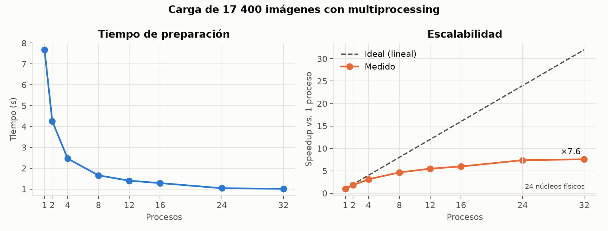
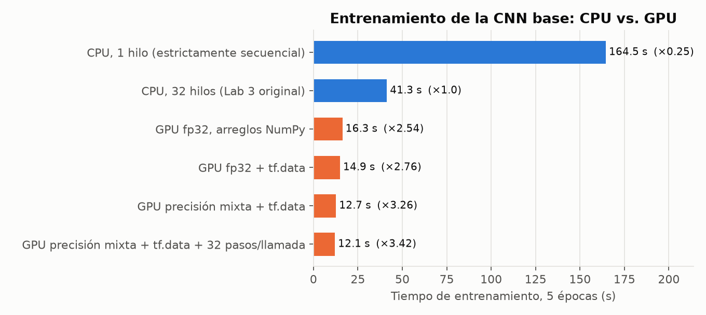
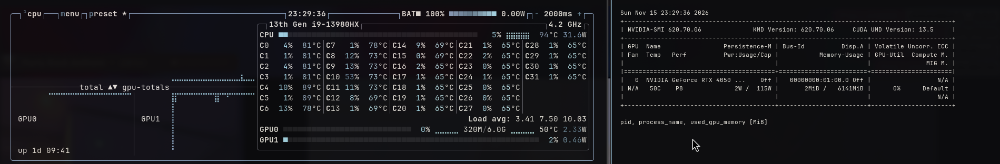
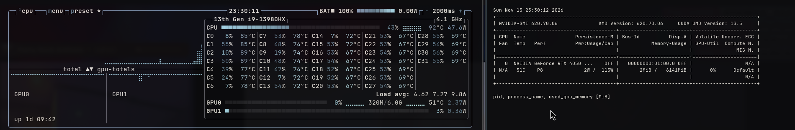
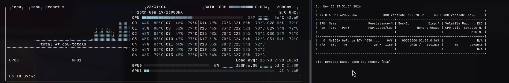
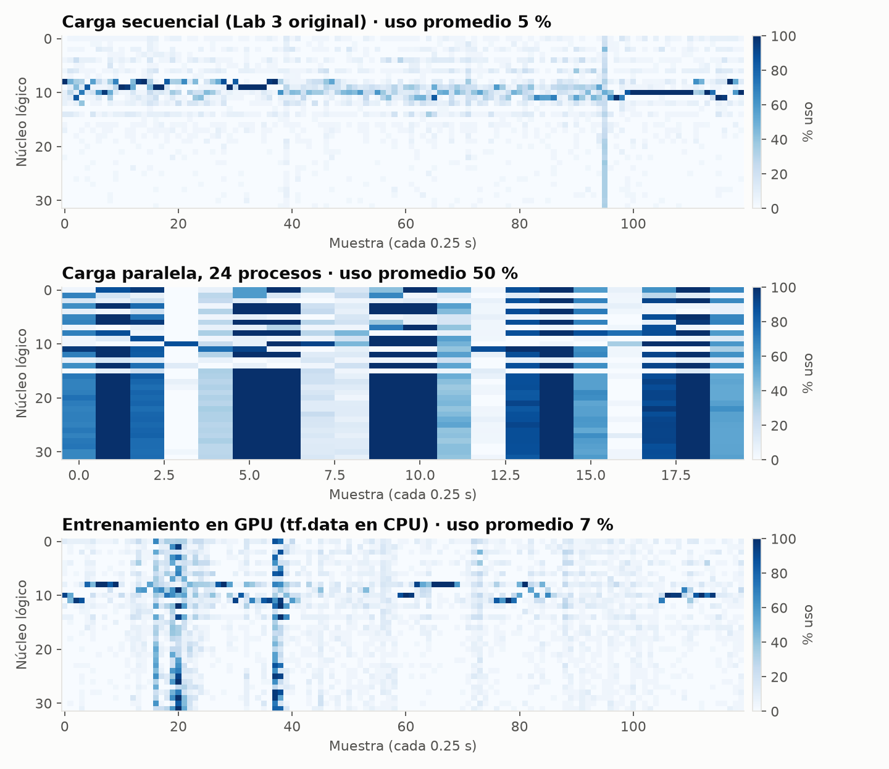
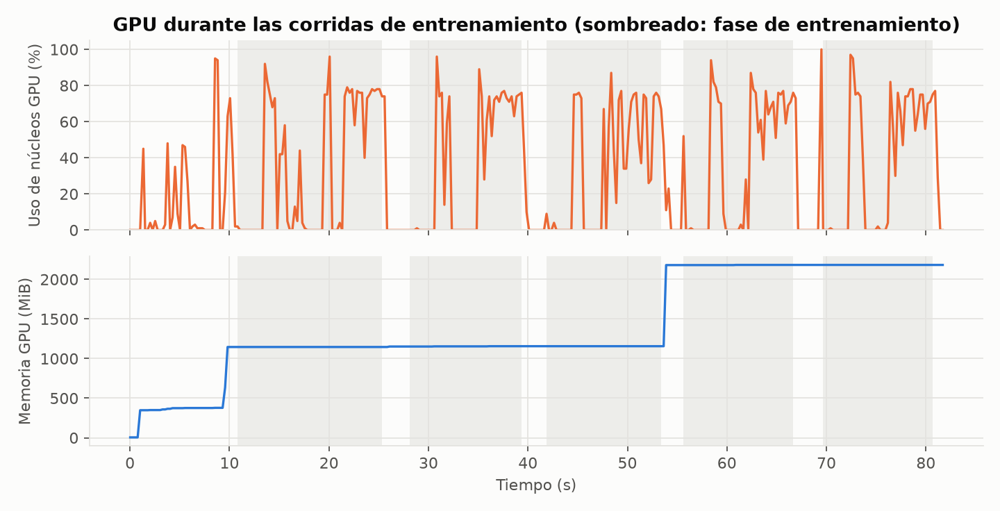

# Proyecto 3 — Mejorando algoritmos con CUDA

**CC3069 Computación Paralela y Distribuida · Universidad del Valle de Guatemala · Semestre II 2026**

Diego López (`dlop6`) · Nicolás Concuá (`NicoCT04`) · Esteban Cárcamo (`ecarcamo`) · 15 de noviembre de 2026

> Algoritmo acelerado: **Laboratorio 3 de Data Science, clasificador del alfabeto de señas americano (ASL)** con una
> red neuronal convolucional en TensorFlow/Keras. Repositorio: `github.com/ecarcamo/Proyecto3-Paralela`.

## 1. Resumen

El pipeline original lee 17 400 fotografías una por una en un solo hilo de Python y entrena la CNN en el CPU. Se
separó en dos mundos: los **archivos** se procesan con los **24 núcleos físicos del CPU** (`multiprocessing` con
memoria compartida) y la **matemática de la red neuronal** se ejecuta en la **GPU con CUDA**, tanto con TensorFlow
(cuDNN/cuBLAS, precisión mixta) como con kernels propios escritos en CUDA Python (Numba).

| Fase | Secuencial (s) | Optimizada (s) | Speedup |
|---|---|---|---|
| Preparación de datos (CPU) | 10.348 ± 2.124 | 1.224 ± 0.255 | **×8.45** |
| Entrenamiento, 5 épocas (GPU) | 41.312 ± 1.697 | 12.086 ± 1.521 | **×3.42** |
| Inferencia, 2 610 imágenes (GPU) | 0.698 ± 0.083 | 0.668 ± 0.247 | ×1.05 |
| **Total del pipeline** | **52.358 ± 2.648** | **14.007 ± 1.203** | **×3.74** |

Con el dataset completo (5 veces más imágenes), el entrenamiento acelera **×4.95** y la preparación **×9.47**. Los
kernels propios en Numba CUDA ejecutan la inferencia **65 veces** más rápido que la misma matemática en NumPy. La
accuracy no cambia: 0.933 en CPU y 0.931 en GPU.

## 2. Datos, hardware y procedimiento

**Datos.** *ASL Alphabet* de Kaggle (`grassknoted/asl-alphabet`): 87 000 imágenes JPG de 200×200 RGB en 29 clases
(A–Z, `del`, `nothing`, `space`). Igual que en el laboratorio se usa una submuestra de 600 imágenes por clase con
semilla 42 (17 400 imágenes, `setup_dataset.py`), reducidas a 64×64 y separadas 70/15/15 de forma estratificada
(12 180 de entrenamiento, 2 610 de validación y 2 610 de prueba). Para medir escalabilidad también se usó el dataset
completo (60 900 / 13 050 / 13 050).

**Modelo.** La CNN base que ganó en el laboratorio: Conv(32)–Pool–Conv(64)–Pool–Conv(128)–Pool–Dense(128)–Dense(29),
con 1 145 693 parámetros y 42.3 M multiplicaciones-sumas por imagen. Adam con lr = 1e-3, batch de 32.

| Hardware | |
|---|---|
| CPU | Intel Core i9-13980HX: 24 núcleos (8P + 16E), 32 hilos |
| GPU | NVIDIA RTX 4050 Laptop: 20 SM, 6 GB, compute capability 8.9 |
| Software | Python 3.11, TensorFlow 2.21 (CUDA 12.5, cuDNN 9), Numba 0.68 + numba-cuda 0.30, driver 620.70 |

**Procedimiento.**

* Todas las mediciones salen de una sola ejecución de `scripts/run_all_benchmarks.sh`, con la laptop conectada a la
  corriente y sin otras cargas pesadas.
* En la submuestra hay 5 corridas por configuración (3 en el dataset completo) y se reporta promedio ± desviación
  estándar.
* El entrenamiento usa siempre **5 épocas fijas** sin paro temprano, para que todas las versiones hagan el mismo
  trabajo.
* Antes de medir se calienta la caché de disco (una carga sin medir) y, en GPU, se hace un entrenamiento corto sin
  medir que absorbe la inicialización de CUDA/cuDNN (7.7–9.5 s, que se reporta aparte).
* Durante cada corrida, un hilo registra el uso de los 32 núcleos lógicos (`psutil`) y otro el de la GPU
  (`nvidia-smi` cada 250 ms). Todo queda en `logs/`.

**Decisiones tomadas:**

* La referencia en CPU es el código original con TensorFlow usando los 32 hilos, que es la versión más rápida. La
  versión estrictamente secuencial (1 hilo) también se midió: es ×4.0 más lenta, pero compararse contra ella inflaría
  el speedup.
* El speedup se calcula por fase y para el pipeline completo.
* El total optimizado suma la transferencia explícita del conjunto de entrenamiento a la GPU.

## 3. Análisis de la solución secuencial (pasos 1 y 2)

Detalle completo en `docs/01_analisis_secuencial.md`. El programa se descompone en: listado de archivos, split
estratificado, lectura + decodificación JPEG, redimensionamiento, normalización ÷255, codificación de etiquetas,
propagación hacia adelante, pérdida, retropropagación, actualización Adam, validación por época e inferencia.

| Operación repetitiva | Datos que procesa | Repeticiones por corrida |
|---|---|---|
| Lectura + decodificación + resize | JPG de 200×200×3 → 64×64×3 | 17 400 |
| Normalización ÷255 | 12 288 valores por imagen | 213.8 M divisiones |
| Paso de entrenamiento (adelante + atrás + Adam) | Batch de 32 imágenes, 1.1 M parámetros | 381 por época × 5 = 1 905 |
| Propagación (convoluciones + densas) | 42.3 M MAC por imagen | 60 900 de entrenamiento + 13 050 de validación + 2 610 de prueba |

| Fase (original, CPU) | Tiempo (s) | % del total | Núcleos ocupados |
|---|---|---|---|
| Preparación de datos | 10.348 ± 2.124 | 20 % | ≈ 1.6 de 32 |
| Entrenamiento | 41.312 ± 1.697 | 79 % | ≈ 19 de 32 |
| Inferencia | 0.698 ± 0.083 | 1 % | ≈ 15 de 32 |

La preparación es un bucle de 17 400 iteraciones independientes que corre en un solo núcleo. El entrenamiento domina
el tiempo y TensorFlow ya lo reparte en hilos, pero de 1 a 32 hilos solo acelera ×4.0 (164.5 s → 41.3 s). Factores
observados: temperatura (CPU entre 90 y 96 °C), caché de disco, GIL de Python, núcleos híbridos P/E y batches pequeños.

## 4. Oportunidades de paralelización (paso 3)

Detalle en `docs/03_paralelizacion_cpu.md`.

| Operación | Paralelismo | Dónde | Por qué |
|---|---|---|---|
| Decodificar + redimensionar JPG | De tareas: cada imagen es independiente | CPU, 24 procesos | Trabajo irregular con ramas (Huffman, libjpeg) y archivos en memoria del host; el GIL obliga a usar procesos |
| Normalizar, barajar, armar batches | Vectorizado y en tubería | CPU (`tf.data`) | Barato; se solapa con el cómputo de la GPU gracias a `prefetch` |
| Convoluciones, densas, softmax, retropropagación, Adam | De datos: millones de MAC idénticas | GPU (CUDA) | Miles de hilos haciendo la misma operación; *tensor cores* para FP16 |

## 5. Diseño del algoritmo paralelo (paso 4)

Detalle en `docs/04_diseno_cuda.md`.

**CPU.** El proceso principal crea un bloque de `multiprocessing.shared_memory` de N×64×64×3 bytes y reparte tareas
de 64 rutas con `imap_unordered` (balanceo dinámico entre núcleos P y E). Cada trabajador decodifica, redimensiona y
escribe los píxeles directamente en el bloque. El pool se crea con `fork` **antes** de inicializar TensorFlow y se
reutiliza. Con `spawn`, 32 procesos tardaban 9.6 s, porque cada uno volvía a importar las librerías.

**GPU con TensorFlow.** `tf.data` en el CPU (barajar, batch de 32, `uint8 → float32`, `prefetch`) alimenta a la GPU.
Ahí la política `mixed_float16` usa los *tensor cores* y `steps_per_execution=32` despacha 32 pasos de
entrenamiento por cada llamada de Python. cuDNN elige la configuración de cada kernel de convolución.

**GPU con kernels propios (CUDA Python / Numba).** Batches de 256 imágenes en formato NCHW:

| Kernel | Un hilo calcula | Bloque | Grid |
|---|---|---|---|
| `conv3x3_relu_tiled` (3 capas) | 1 píxel × 8 canales de salida, con un mosaico de 18×18 en memoria compartida | 16×16 | (⌈W/16⌉, ⌈H/16⌉, B·C_out/8) |
| `maxpool2x2` | 1 píxel de salida | 16×16 (8×8 en la última) | (⌈W/16⌉, ⌈H/16⌉, B·C) |
| `dense` (+ReLU) | 1 neurona de 1 imagen; la entrada en mosaicos de 128 en memoria compartida | 128 | (⌈N_out/128⌉, B) |
| `softmax_rows` | 1 imagen completa | 128 | (⌈B/128⌉) |

El eje `z` del grid codifica imagen y canal, así que todos los hilos de un bloque usan los mismos pesos (difusión desde
la caché) y los hilos vecinos en `x` leen memoria contigua (accesos agrupados). Los tiempos se miden con `cuda.event`,
separando las copias CPU→GPU, los kernels y las copias GPU→CPU.

## 6. Resultados (paso 5)

### 6.1 Tabla comparativa de tiempos y speedup por fase


| Fase | Secuencial (s) | Optimizada (s) | Speedup | Dataset completo |
|---|---|---|---|---|
| Preparación de datos | 10.348 ± 2.124 | 1.224 ± 0.255 | ×8.45 | ×9.47 (35.70 → 3.77 s) |
| Transferencia CPU→GPU del conjunto | — | 0.028 | — | 0.34 s |
| Entrenamiento (5 épocas) | 41.312 ± 1.697 | 12.086 ± 1.521 | ×3.42 | ×4.95 (193.28 → 39.09 s) |
| Inferencia | 0.698 ± 0.083 | 0.668 ± 0.247 | ×1.05 | — |
| **Total** | **52.358** | **14.007** | **×3.74** | — |

* La preparación optimizada (1.224 s) es la medida dentro del pipeline completo. Sola, en su benchmark, tarda
  1.042 s (**×9.93**).
* En entrenamiento, sin la primera corrida (trazado del grafo y autotuning de cuDNN para formas nuevas) el speedup
  estable es **×3.56**.
* La inferencia de 2 610 imágenes casi no mejora de punta a punta, porque la domina el costo fijo de preparar el grafo
  en cada `predict`. Con el modelo ya trazado, Keras en GPU tarda 0.207 s.

### 6.2 Preparación de datos en el CPU



El óptimo son 24 procesos, uno por núcleo físico. Con 32 (*hyper-threading*) no mejora o empeora. La eficiencia cae
porque los núcleos E son más lentos y porque crear el pool, copiar y normalizar quedan en el proceso principal (ley de
Amdahl). Los píxeles son **idénticos bit a bit** a los de la versión original (`results/cpu_parallel_equivalence.json`).

### 6.3 Entrenamiento en la GPU



Cada optimización suma: mover el mismo código a la GPU da ×2.54, `tf.data` con `prefetch` ×2.76, la precisión mixta
×3.26 y `steps_per_execution` ×3.42. La GPU estuvo ocupada en promedio solo el 36 % del entrenamiento con la
submuestra y el 55 % con el dataset completo. El modelo es pequeño y la GPU espera a que el CPU le despache cada paso.

### 6.4 Kernels propios en CUDA Python


| Implementación (2 610 imágenes) | Tiempo (s) | Speedup vs. NumPy |
|---|---|---|
| NumPy en CPU | 18.744 ± 1.219 | 1 |
| Numba CUDA ingenuo | 0.566 | 33 |
| **Numba CUDA con memoria compartida** | **0.289** | **65** |
| Keras sobre cuDNN | 0.207 | 90 |

La versión con memoria compartida y 8 canales por hilo duplica la velocidad de las convoluciones, que son más del
80 % del tiempo. Las predicciones coinciden con Keras en 2 609 de 2 610 imágenes; la diferencia máxima de probabilidad
es de 2.7·10⁻³, por el TF32 que usa cuDNN. De las 0.289 s, solo 17.5 ms son copia a la GPU y 0.4 ms copia de regreso.

### 6.5 Transferencias CPU ↔ GPU

| Conjunto de entrenamiento | Tamaño | CPU → GPU | GPU → CPU |
|---|---|---|---|
| `float32` | 570.9 MB | 0.096 s (5.8 GB/s) | 1.018 s (0.56 GB/s) |
| `uint8` | 142.7 MB | 0.028 s (5.5 GB/s) | 0.157 s (0.96 GB/s) |

## 7. Evidencia del uso de recursos

Capturas de `btop` (los 32 núcleos y la GPU) y de `nvidia-smi`, tomadas mientras corría cada fase
(`scripts/demo_workload.py`):

**Carga secuencial: un solo núcleo trabaja** (C10 al 53 %, el resto en reposo).


**Carga paralela con 24 procesos: todos los núcleos trabajan.**


**Entrenamiento original en CPU: los 32 hilos ocupados y la GPU en 0 %.**


**Entrenamiento optimizado: la GPU al 76 %, 52 W y el proceso `python` con memoria en la GPU; el CPU al 4 %.**


Los monitores de las corridas medidas confirman lo mismo con todas las muestras:





## 8. Discusión técnica

### 8.1 ¿Por qué es más eficiente procesar las imágenes con los múltiples núcleos del CPU y delegar exclusivamente la matemática de la red neuronal a la GPU?

Porque cada tipo de trabajo encaja con un hardware distinto:

* **Los archivos viven en el CPU.** Los JPG están en el disco y en la caché de páginas del sistema operativo, que
  pertenece al CPU. Para que la GPU los procesara habría que copiarlos por PCIe, sin reducir ni normalizar: 120 000
  bytes por imagen en vez de 12 288, casi 10 veces más tráfico por un bus que en nuestras mediciones da 5.5–5.8 GB/s.
* **Decodificar un JPEG es trabajo irregular.** Implica decodificación Huffman (secuencial dentro de cada imagen),
  muchas ramas y acceso a tablas, todo hecho por libjpeg a través de PIL. Los núcleos del CPU, con predicción de saltos
  y cachés grandes, ejecutan bien ese código. En la GPU, los 32 hilos de un warp tendrían que seguir caminos distintos
  (divergencia) y se perdería el paralelismo.
* **El paralelismo natural de esta fase es de tareas, no de datos.** Hay 17 400 imágenes independientes, cada una con
  ~0.6 ms de trabajo. Eso se reparte perfecto entre 24 procesos: la preparación pasó de 10.35 s a 1.04 s (**×9.9**),
  con 21 núcleos por encima del 50 % de uso en lugar de 1. Con hilos no se logra, porque el GIL de Python los
  serializa.
* **La red neuronal es exactamente al revés.** 42.3 M multiplicaciones-sumas idénticas por imagen, organizadas en
  tensores regulares: paralelismo de datos masivo, justo para lo que existen los miles de hilos CUDA y los
  *tensor cores*. En el CPU, ni con 32 hilos el entrenamiento pasa de ×4.0 respecto a un hilo.
* **Así los dos trabajan a la vez.** Con `tf.data` y `prefetch`, el CPU prepara el siguiente batch mientras la GPU
  calcula el actual. Durante el entrenamiento en GPU el CPU queda casi libre (6 % de uso promedio) y la GPU recibe
  tensores listos. Si todo se hiciera en un solo dispositivo, uno de los dos estaría ocioso.

### 8.2 ¿Cómo CUDA permitió reducir o cambiar el tiempo de procesamiento?

* **Redujo el entrenamiento de 41.3 s a 12.1 s (×3.42).** Cada época pasó de 8.26 s a 2.42 s, y con el dataset
  completo de 38.7 s a 7.8 s por época (×4.95). La GPU ejecuta en paralelo, con miles de hilos, las convoluciones y
  productos de matrices que en el CPU se reparten entre 32 hilos como mucho. Con los kernels propios se ve en cifras:
  la misma matemática tarda 18.7 s en NumPy y 0.29 s en CUDA (×65).
* **El diseño de los kernels importa.** Pasar de «1 hilo = 1 salida leyendo todo de memoria global» a mosaicos en
  memoria compartida con 8 canales por hilo duplicó la velocidad de las convoluciones (22.1 → 10.0 ms por batch). La
  memoria global es mucho más lenta que la compartida y los registros: reutilizar cada dato cargado vale tanto como
  tener más hilos.
* **Los *tensor cores* y la precisión mixta** (FP16 en el cómputo, FP32 en los pesos) bajaron el entrenamiento de
  14.9 s a 12.7 s, sin perder accuracy.
* **CUDA también cambió dónde se va el tiempo.** En la versión secuencial el 79 % era cómputo de la red. En la
  optimizada aparecen costos que antes no existían: inicializar CUDA/cuDNN (7.7–9.5 s por proceso), compilar los
  kernels JIT de Numba (1.7 s), trazar el grafo y el autotuning de cuDNN (~3 s en la primera corrida). Además, el
  overhead de Python por cada paso de entrenamiento: con batches de 32 la GPU pasa buena parte del tiempo esperando.
  Por eso `steps_per_execution=32`, que no cambia ningún cálculo, mejoró el tiempo, y por eso la GPU solo estuvo
  ocupada 36 % del tiempo en promedio.

### 8.3 ¿Qué factores justifican o limitan la utilización de CUDA?

**La justifican:**

* **Volumen de cómputo regular:** 7.7 TMAC por entrenamiento de 5 épocas, todas operaciones idénticas e
  independientes dentro de cada batch.
* **Escala de los datos:** al pasar de 17 400 a 87 000 imágenes, el speedup sube de ×3.4 a ×4.95, porque los costos
  fijos se amortizan. Con un modelo o imágenes más grandes la ventaja crecería más.
* **Entrenamientos repetidos:** en el laboratorio se probaron 5 configuraciones de hiperparámetros, más el
  re-entrenamiento con aumento de datos. Con la GPU, cada una cuesta la cuarta parte y el costo de inicializar CUDA se
  paga una sola vez por proceso.

**La limitan:**

* **El modelo es pequeño** (1.1 M parámetros, imágenes de 64×64, batch de 32): no alcanza para llenar los 20 SM. La
  GPU promedió 36 % de uso y 30 W de los 140 W disponibles. Se gasta más en lanzar kernels y despachar desde Python
  que en calcular.
* **Costos fijos:** inicializar CUDA/cuDNN (7.7–9.5 s), compilar JIT y trazar el grafo. Para un solo entrenamiento
  corto se comen buena parte de la ganancia: 12.1 s de entrenamiento + 9.4 s de inicialización = 21.5 s, contra 41.3 s
  en CPU. Sigue siendo ×1.9, pero lejos del ×3.4.
* **Memoria de la GPU (6 GB):** el dataset completo en `float32` ocupa 4.3 GB y no cabe junto con las activaciones. Por
  eso se guarda como `uint8` y se normaliza por batch.
* **Transferencias por PCIe:** subir el conjunto completo cuesta menos del 1 %, pero bajar datos es lento
  (0.56 GB/s). Un diseño que fuera y viniera entre CPU y GPU en cada paso perdería la ventaja.
* **Partes que siguen siendo secuenciales** (ley de Amdahl): crear procesos, armar el grafo, la validación de cada
  época y el código de Python que coordina todo.
* **Complejidad y precisión numérica:** se necesitaron versiones compatibles de CUDA (TensorFlow trae CUDA 12 y el
  sistema tiene CUDA 13) y precargar `libcusolver`. cuDNN usa TF32 y FP16, así que los resultados difieren en el orden
  de 10⁻³ (1 predicción distinta de 2 610). La laptop también limita: con el CPU a 90–96 °C hubo variación de ±2 s.

### 8.4 Librerías y funciones que permiten trabajar con la GPU

| Librería / función | Uso en el proyecto |
|---|---|
| `tensorflow[and-cuda]` 2.21 | Trae CUDA 12.5, cuDNN 9, cuBLAS, cuFFT y cuSOLVER como paquetes de pip; `tf.config.list_physical_devices("GPU")`, `set_memory_growth`, `tf.device("/GPU:0")` |
| cuDNN / cuBLAS | Convoluciones, pooling y productos de matrices que TensorFlow ejecuta en la GPU |
| `tf.keras.mixed_precision.set_global_policy("mixed_float16")` | Cómputo en FP16 sobre *tensor cores* |
| `model.compile(steps_per_execution=32)` | Agrupa 32 pasos de entrenamiento por llamada a la GPU |
| `tf.data` (`map(num_parallel_calls)`, `prefetch`) | Pipeline del CPU que alimenta a la GPU sin detenerla |
| `tf.test.experimental.sync_devices()` | Sincronización para medir transferencias |
| `numba.cuda` (`@cuda.jit`, `cuda.grid`, `cuda.blockIdx`, `cuda.shared.array`, `cuda.local.array`, `cuda.syncthreads`) | Kernels propios: convolución, pooling, densas y softmax |
| `cuda.to_device`, `device_array`, `copy_to_host`, `cuda.event` | Memoria de la GPU, copias y medición de tiempos con eventos |
| `numba-cuda[cu12]`, `cuda-bindings` | Compilador de Numba para CUDA 12 (comparte librerías con TensorFlow) |
| `nvidia-smi --query-gpu ... -lms 250` | Monitoreo de uso, memoria, potencia y reloj de la GPU |

## 9. Conclusiones

1. Separar el pipeline por tipo de trabajo redujo el tiempo total de **52.4 s a 14.0 s (×3.74)** con la misma
   accuracy. Los archivos en los núcleos del CPU (×8.5–9.9) y la red neuronal en la GPU (×3.4 en la submuestra y ×4.95
   en el dataset completo).
2. La preparación de datos era un bucle secuencial escondido que ocupaba un solo núcleo. Paralelizarla con procesos y
   memoria compartida fue la mejora más grande y la más barata.
3. CUDA acelera la matemática, pero con un modelo pequeño la GPU queda subutilizada. Los costos fijos
   (inicialización, trazado, despacho desde Python) definen cuánto se gana; por eso la ventaja crece con más datos.
4. Escribir los kernels con Numba mostró cómo repartir el trabajo en hilos, bloques y grids. También mostró que el uso
   de la memoria compartida pesa tanto como el número de hilos: la versión con mosaicos duplicó a la ingenua y llegó a
   1.4 veces el tiempo de cuDNN.

## 10. Contribuciones

| Integrante | Responsabilidad | Commits principales |
|---|---|---|
| Diego López (`dlop6`) | Línea base secuencial, medición y análisis | Traslado del Lab 3 (`src/sequential/`), medición por fases y monitor de núcleos (`src/benchmark/`), análisis de los pasos 1–2, corrida final de benchmarks, comparación y figuras (`analysis/`), notebook e informe |
| Nicolás Concuá (`NicoCT04`) | Preparación de datos en paralelo en el CPU | Carga con `multiprocessing` y memoria compartida (`src/parallel_cpu/`), escalabilidad de 1 a 32 procesos y `fork` vs `spawn`, pipeline `tf.data`, pool persistente, análisis del paso 3 y discusión 8.1 |
| Esteban Cárcamo (`ecarcamo`) | Entorno CUDA y GPU | Entorno e inventario de hardware, entrenamiento en GPU (`src/gpu/train.py`), monitor de `nvidia-smi`, kernels Numba CUDA (`src/gpu/kernels.py`), diseño y resultados de los pasos 4–5 y discusión 8.2–8.4 |

Por autorización del catedrático, todo se ejecutó en la computadora de Esteban, porque las de los otros dos
integrantes se dañaron. Cada commit lleva el usuario de quien hizo esa parte.

## Anexo: cómo reproducir

```bash
uv venv --python 3.11 .venv
uv pip install --python .venv/bin/python -r requirements.txt
.venv/bin/python setup_dataset.py
./scripts/run_all_benchmarks.sh
.venv/bin/python -m analysis.compare
.venv/bin/jupyter nbconvert --to notebook --execute --inplace notebooks/proyecto3.ipynb
.venv/bin/python report/build_report.py
```
